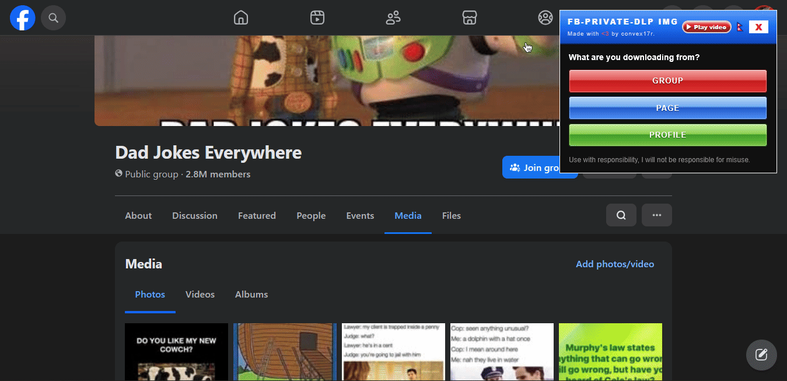
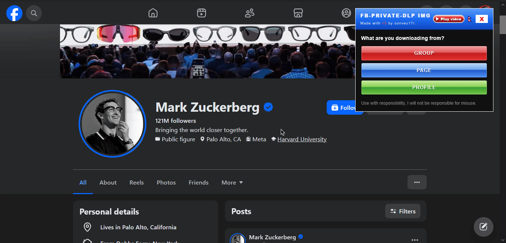

<p align="center">
   
</p>

<h1 align="center">fb-private-dlp project</h1>

<p align="center"><b>Download Private Facebook Group, Page and Profile media <br> [⚡ Highest quality] [Bulk + Individual]; with [⚡ auto-file naming].</br> </b></p>

<p align="center">
  
  
  
  
  
</p>

<p align="center"><i>uses yt-dlp, gallery-dl, aria2c*, ffmpeg.</i></p>


<p align="center">
  <a href="https://www.virustotal.com/gui/file/10033ab1954f80cb45aa289663da6e335e48051c6c6f0d379b7245f17f5d465f/detection">🔍 Virustotal Scan Result Link [fb-private-dlp-img.js] </a>
</p>

<p align="center">
  <a href="https://www.virustotal.com/gui/file/e9ea75cacc251afdf13dea60e6c6bfc4f7aa9ffa59fa06df8362a4b4bc138cf7/detection">🔍 Virustotal Scan Result Link [fb-private-dlp-vid.js] </a>
</p>

<p align="center">
  
</p>

<p align="center">
  
</p>

<p align="center"> <b>🚧 Coming Soon... [Video Tutorial + Showcase] </b> </p>


<p align="center">Supported OS: <b>[macOS, Linux, Windows]</b></p>
<p align="center">
  
</p>

---

## ⚙ Usage:

1. [Installing Tools](#1-install-the-tools)

2. [Cookie Usage](#2-set-up-cookies-required-for-private-media)

    A. [Get COOKIES.TXT Locally](#a-cookiestxt)

    B. [Auto Browser cookie import](#b-browser-cookie)

3. [Console Run](#3-load-the-console-script)

4. [Images — usage](#4-images-usage)

5. [Videos — usage](#5-videos-usage)

---

## 1. Install the tools

- Install the download-tools by using commands below. For videos you need **yt-dlp + ffmpeg** (**aria2c** _optional, faster_). <br> For photos you need **gallery-dl** only. </br>

<details close>
<summary><b>Windows (PowerShell/cmd)</b></summary>
<br />

<p align="center">
  
</p>

```powershell
# videos
winget install -e --id yt-dlp.yt-dlp
winget install -e --id Gyan.FFmpeg
winget install -e --id aria2.aria2

# photos
winget install -e --id mikf.gallery-dl
```

**Verify (run these):**

```powershell
yt-dlp --version
ffmpeg -version
gallery-dl --version
```

</details>

<details close>
<summary><b>macOS (Terminal)</b></summary>
<br />

<p align="center">
  
</p>

```bash
# videos
brew install yt-dlp ffmpeg aria2

# photos
brew install gallery-dl
```

**Verify (run these):**

```bash
yt-dlp --version
ffmpeg -version
gallery-dl --version
```

</details>

<details close>
<summary><b>Linux (Terminal/Shell)</b></summary>
<br />

<p align="center">
  
</p>

```bash
# videos
sudo apt update && sudo apt install -y yt-dlp ffmpeg aria2

# photos
sudo apt update && sudo apt install -y gallery-dl
# use pip instead if your distro has no apt-package:
python3 -m pip install --user gallery-dl
```

Verify:

```bash
yt-dlp --version
ffmpeg -version
gallery-dl --version
```

</details>

---

## 2. Set up cookies (required for private media)

The downloader (`yt-dlp` & `gallery-dl`) must have proof for Facebook that you are logged in. cookies are your proof.

| Method | How |
| ------ | --- |
| **A. cookies.txt file**<a id="a-cookiestxt"></a> (most reliable) | Install the [Get cookies.txt LOCALLY](https://chromewebstore.google.com/detail/cclelndahbckbenkjhflpdbgdldlbecc) browser extension → open `facebook.com` → export → save as `cookies.txt` next to the downloaded `.bat` file, then choose `cookies.txt file` in the panel. |
| **B. Read from browser (fastest) (recommended)**<a id="b-browser-cookie"></a> | In the script panel, [how to run script?](#3-load-the-console-script); pick the browser you are logged in with. **Completely close that browser** before running the `.bat` (Chrome / Edge / Brave lock their cookie database while running; **Firefox does not need closing**). |

> [!WARNING]
> Sometimes in **Method B** **eset-Antivirus's** **Advanced Browser Data Protection** may block the cookies from being accessed; go to ESET Dashboard → Click <kbd>F5</kbd> → Go to <kbd>Browser Protection</kbd> → Turn off <kbd>Advanced Data Protection</kbd>
>
> 

---

## 3. Load the console script

FOLLOW these steps: or [Watch this video tutorial/showcase](https://youtube.com/watch?v=apojcksnx)

1. Login to the **Facebook account from where you can access the private media**
2. Either go to FB Media Tab **(for bulk download (img + vid))** or Feeds **(for selective click download (only vid supported))**
3. Open console by clicking <kbd>Ctrl</kbd> + <kbd>Shift</kbd> + <kbd>I</kbd> or simply press <kbd>F12</kbd> button
4. Open the script in Notepad and **copy** it → **Paste** it in your browser site console:
    - Photos: [`fb-private-dlp-img.js`](./fb-private-dlp-img.js) 
    - Videos: [`fb-private-dlp-vid.js`](./fb-private-dlp-vid.js) 
5. Hit <kbd>Enter</kbd> — the panel will appear in right side. <br> Pick either **CLICK MODE (only vid supported)** or **BULK MODE** **(img + vid supported)**, </br> choose your **COOKIES SOURCE** as per [Earlier Discusison](#2-set-up-cookies-required-for-private-media), then click <kbd><b> DOWNLOAD .BAT </b></kbd>
6. Move the `fb-private-dlp-xxxx.bat` into an empty folder; where you want your media to be downloaded; <br> (keep `cookies.txt` next to it if you picked [Method A](#a-cookiestxt)) and **double-click run** it. </br>

> **Refreshing** the site will **remove** the progress of captured media links.

---

## 4. Images — usage <a id="4-images-usage"></a>

> 
>
> **Demo shows public profile and group; private profiles and groups work too**
> 
> 
>
> **After this you can run the `.bat` file on target folder.**

## 5. Videos — usage <a id="5-videos-usage"></a>


-----

<sub> P.S. Special Thanks to OC Zen for help in this project. </sub>
