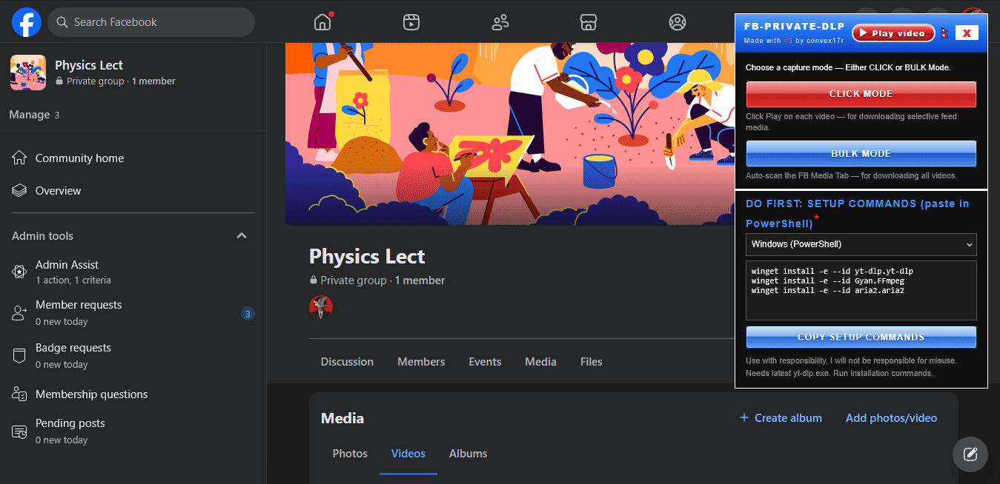
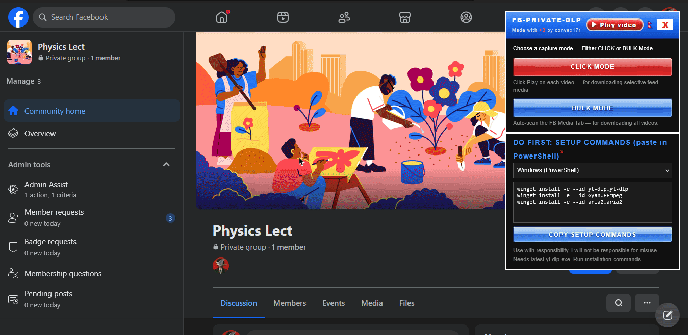

<p align="center">
  
</p>

<h1 align="center">fb-private-dlp project</h1>

<p align="center"><b>Download Private Facebook Group, Page and Profile media [Photo + Video] <br> [⚡ Highest quality downloads] [Bulk + Individual]; with [⚡ auto-file naming capabilities].</br> </b></p>

<p align="center">
  
  
  
  
  
  
</p>

<p align="center"><i>uses: <b>yt-dlp</b>, <b>gallery-dl</b>, <b>ffmpeg</b>, and <b>aria2c</b>* </i></p>

<p align="center">
  <a href="https://www.virustotal.com/gui/file/10033ab1954f80cb45aa289663da6e335e48051c6c6f0d379b7245f17f5d465f/detection">🔍 VirusTotal — <code>fb-private-dlp-img.js</code></a>
  &nbsp;•&nbsp;
  <a href="https://www.virustotal.com/gui/file/e9ea75cacc251afdf13dea60e6c6bfc4f7aa9ffa59fa06df8362a4b4bc138cf7/detection">🔍 VirusTotal — <code>fb-private-dlp-vid.js</code></a>
</p>

<p align="center">
  
  
</p>

<p align="center">Supported OS: <b>[macOS, Linux, Windows] <br /> Checked & Verified running in Windows.</b></p>

<p align="center">
  
</p>

<p align="center"> <b>🚧 Coming Soon... [Video Tutorial + Showcase] 🚧</b> </p>

---

## Features

| | |
| :- | :- |
|  **Images (bulk)** | Download all photos uploaded from private groups, pages & individual profiles |
|  **Videos (bulk + click)** | Bulk video download from private groups, profile & pages; also supports selective feed download |
|  **Highest quality** | Downloaded media has the highest possible resolution |
|  **Auto file naming** | Media files are named automatically from the post caption or id; renaming also possible in panel |
|  **Two cookie methods** | `cookies.txt`, or direct cookie import from logged-in browser of choice |
|  **3 OS Supported** | Windows, macOS & Linux supported. [`.bat` / `.command` / `.sh`]  |

---

## Table of Contents

1. [Install the tools](#1-install-the-tools)
2. [Set up cookies (required for private media)](#2-set-up-cookies-required-for-private-media)
   - A. [Get `cookies.txt` locally](#a-cookiestxt)
   - B. [Auto browser cookie import](#b-browser-cookie)
3. [Load the console script](#3-load-the-console-script)
4. [Images — usage](#4-images-usage)
5. [Videos — usage](#5-videos-usage)

---

## 1. Install the tools

| Tool | Job | Need for |
| :- | :- | :- |
| [yt-dlp](https://github.com/yt-dlp/yt-dlp) | Downloads the videos | 🎬 Videos |
| [ffmpeg](https://github.com/ffmpeg/ffmpeg) | Merges best video + audio streams | 🎬 Videos |
| [aria2c](https://github.com/aria2/aria2) | Speeding up downloads, good for large video downloads *(optional)* | 🎬 Videos |
| [gallery-dl](https://github.com/mikf/gallery-dl) | Downloads the photos | 🖼️ Images |

**Install the download tools with the commands below:**

<details close>
<summary><b>Windows (PowerShell / cmd)</b></summary>
<br />

<p align="left">
  
</p>

```powershell
# videos
winget install -e --id yt-dlp.yt-dlp
winget install -e --id Gyan.FFmpeg
winget install -e --id aria2.aria2

# photos
winget install -e --id mikf.gallery-dl
```

</details>

<details close>
<summary><b>macOS (Terminal)</b></summary>
<br />

<p align="left">
  
</p>

```bash
# videos
brew install yt-dlp ffmpeg aria2

# photos
brew install gallery-dl
```

</details>

<details close>
<summary><b>Linux (Terminal / Shell)</b></summary>
<br />

<p align="left">
  
</p>

```bash
# videos
sudo apt update && sudo apt install -y yt-dlp ffmpeg aria2

# photos
sudo apt update && sudo apt install -y gallery-dl
# use pip instead if your distro has no apt-package:
python3 -m pip install --user gallery-dl
```

</details>

----

**Verify installation:**

```bash
yt-dlp --version
ffmpeg -version
gallery-dl --version
```


---

## 2. Set up cookies (required for private media)

The downloader (`yt-dlp` & `gallery-dl`) needs proof for Facebook that you are logged in — **cookies 🍪 are your proof**.

| Method | How |
| :- | :- |
| **A. `cookies.txt` file** <a id="a-cookiestxt"></a> *(most reliable)* | Install the [Get cookies.txt LOCALLY](https://chromewebstore.google.com/detail/cclelndahbckbenkjhflpdbgdldlbecc) browser extension → open `facebook.com` → export → save as `cookies.txt` next to the downloaded script file, then choose `cookies.txt` file in the panel. |
| **B. Read from browser** <a id="b-browser-cookie"></a> *(fastest — recommended)* | In the script panel ([how to run the script?](#3-load-the-console-script)) pick the browser you are logged in with. **Completely close that browser** before running the script file (Chrome / Edge / Brave lock their cookie database while running — **Firefox does not need closing**). |

> [!WARNING]
> With [Method B](#b-browser-cookie), **ESET Antivirus's Advanced Browser Data Protection** may block access to the cookies.
>
> Go to: **ESET Dashboard** → press <kbd>F5</kbd> → **Browser Protection** → turn off **Advanced Data Protection**.
>
> <p></p>

---

## 3. Load the console script

Follow these steps — or [watch the video tutorial / showcase](https://youtube.com/watch?v=xxxxxxxx):

1. **Log in** to the Facebook account that has access to the private media.
2. Go to the **Media Tab** *(for bulk download: img + vid)* or your **Feed** *(for selective click download: vid only)*.
3. Open the console with <kbd>Ctrl</kbd> + <kbd>Shift</kbd> + <kbd>I</kbd>, or just press <kbd>F12</kbd>.
4. Open the script in Notepad, **copy** it, and **paste** it into the site console:
   - image-dl: [`fb-private-dlp-img.js`](./fb-private-dlp-img.js)
   - video-dl: [`fb-private-dlp-vid.js`](./fb-private-dlp-vid.js)
5. Hit <kbd>Enter</kbd> — the panel appears on the right side. Pick **CLICK MODE** *(vid-dl script only)* or **BULK MODE** *(img + vid script)*, choose your **COOKIES SOURCE** per the [earlier discussion](#2-set-up-cookies-required-for-private-media), then click the **download** button.
6. Move the downloaded `fb-private-dlp-xxxx` file into the **folder** where you want the media, *(keep `cookies.txt` next to it if you picked [Method A](#a-cookiestxt))* and double-click run it:

> [!NOTE]
> If any error shows up: first make sure the required tools are installed properly: **yt-dlp + ffmpeg** (+ optional **aria2c**) for videos, **gallery-dl** for images — see [Install the tools section](#1-install-the-tools).
> 
> **Refreshing** the page will **remove** the progress of captured media links.


---

## 4. Images — usage <a id="4-images-usage"></a>

<p align="center"></p>
<p align="center"><i><b>This demo shows a public profile and group; private profiles and groups work too.</i></b></p>

<p align="center"></p>
<p align="center"><i> <b> After this, run the downloaded file in the target folder.</i></b></p>

---

## 5. Videos — usage <a id="5-videos-usage"></a>

<p align="center"></p>
<p align="center"><i><b>Bulk mode: grabs every video from the media tab.</i></b></p>

<p align="center"></p>
<p align="center"><i><b>Click mode: captures media links from feed clicks.</i></b></p>

---

<p align="right"> <sub><i> P.S. Special Thanks to OC Zen for help in this project. </i></sub> </p>
